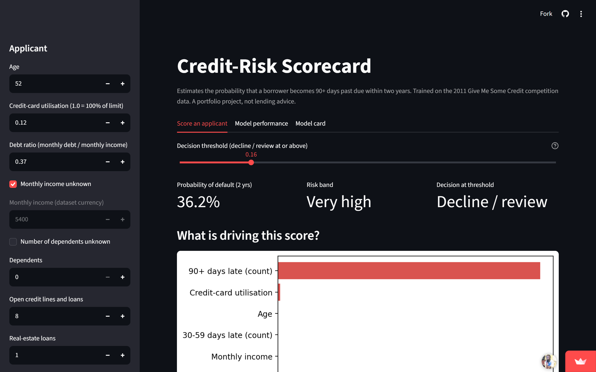
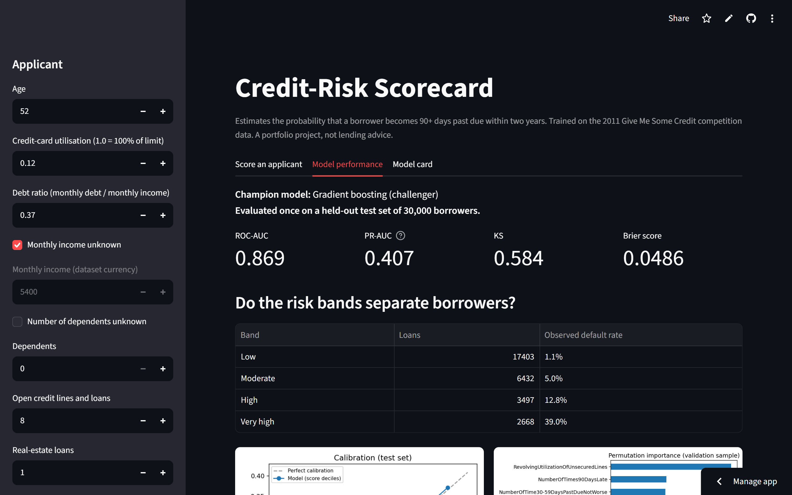
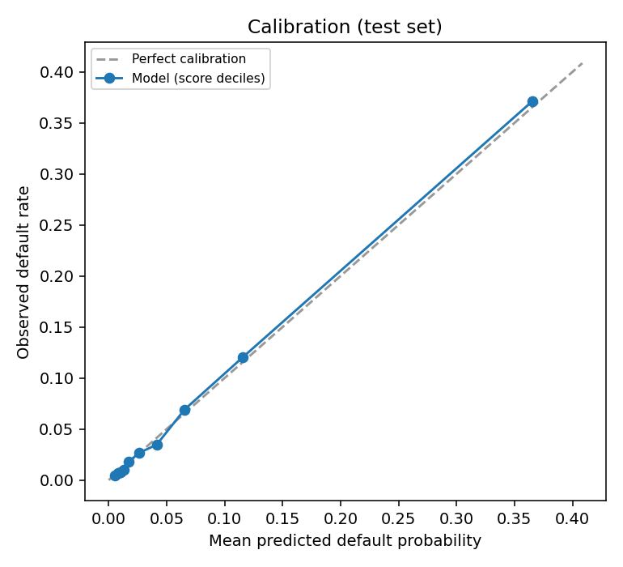
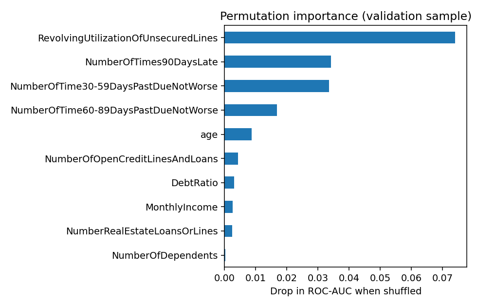

# Credio: Credit-Risk Scorecard


Predicts the probability that a borrower becomes 90+ days past due within two years, using the
[Give Me Some Credit](https://www.kaggle.com/competitions/GiveMeSomeCredit) data (150,000 borrowers, 6.7 % default rate).
Built as a leak-free, tested, reproducible pipeline with a calibrated model, cost-based decision threshold,
risk bands and a Streamlit scoring app.

**Live demo:** https://credio.streamlit.app/ (free hosting: the first load after a quiet period can be slow)

## Results (single evaluation on a held-out test set of 30,000 borrowers)

| Metric | Value | Note |
|---|---|---|
| ROC-AUC | **0.869** | 5-fold CV on training data: 0.864 +/- 0.004 |
| PR-AUC | **0.407** | a no-skill model scores about 0.067 |
| KS statistic | **0.584** | |
| Brier score | 0.0486 | probabilities are well calibrated (see `reports/figures/calibration_test.png`) |

Risk bands separate borrowers cleanly (observed default rate on the test set):

| Band (predicted PD) | Loans | Observed default rate |
|---|---|---|
| Low (< 3 %) | 17,403 | 1.1 % |
| Moderate (3-8 %) | 6,432 | 5.0 % |
| High (8-20 %) | 3,497 | 12.8 % |
| Very high (>= 20 %) | 2,668 | 39.0 % |

At the cost-optimal threshold (0.16, assuming a missed default costs 5x a wrongly declined good borrower)
the model declines 10.7 % of applicants and catches 57 % of defaulters at 36 % precision.
The 5:1 cost ratio is an **assumption**: change `COST_FN` in `creditrisk/config.py` to match another business.

## What I learned

- **Cleaning decisions matter more than the algorithm.** The past-due columns contain special codes (96/98)
  in 269 rows with a 54.6 % default rate, `MonthlyIncome` is missing for 19.8 % of borrowers, and `DebtRatio`
  holds a huge absolute figure (median about 1,159) instead of a ratio when income is missing. The pipeline handles each explicitly.
- **Gradient boosting beat logistic regression** (validation ROC-AUC 0.865 vs 0.823), so it is the champion.
  The rule is written down in advance: keep the simpler scorecard unless the challenger wins by more than 0.005.
- **Rebalancing did not help, and it damaged the probabilities.** On the validation set (`experiments/resampling_check.py`,
  results in `reports/resampling_check.csv`):

  | Variant | ROC-AUC | PR-AUC | Brier (lower is better) |
  |---|---|---|---|
  | Logistic, no resampling | 0.8232 | 0.3542 | 0.0516 |
  | Logistic, class weights | 0.8247 | 0.3554 | 0.1529 |
  | Logistic, SMOTE | 0.8242 | 0.3542 | 0.1535 |
  | Boosting, no resampling | **0.8651** | **0.3936** | **0.0493** |
  | Boosting, class weights | 0.8647 | 0.3914 | 0.1398 |
  | Boosting, SMOTE | 0.8457 | 0.3504 | 0.0601 |

  Both class weights and SMOTE tripled the logistic Brier score because they distort the predicted probabilities,
  and SMOTE made boosting worse on every metric. So the final model uses no resampling. SMOTE here is my own
  implementation (`creditrisk/resampling.py`, tested); installing `imbalanced-learn` adds a cross-check row.
- **Utilisation of credit limits is the strongest signal** (permutation importance, `reports/figures/permutation_importance.png`),
  followed by 90+ day and 30-59 day late counts.

## Screenshots




| Calibration (test set) | Permutation importance |
|---|---|
|  |  |

## Method

1. Stratified 60/20/20 train / validation / test split. The test set is touched once, at the very end.
2. `CreditFeatureBuilder` (in `creditrisk/features.py`) learns medians and caps from training data only and sits
   inside the sklearn pipeline, so cross-validation cannot leak.
3. Two candidates: logistic regression (scorecard) and histogram gradient boosting.
4. Threshold chosen on the validation set by minimising expected cost; risk bands are illustrative PD cut-offs.
5. Local explanations use occlusion (set one input to the training median, see how risk changes). Fast and model-agnostic,
   but it ignores interactions; SHAP would be the exact alternative.

Full details and numbers: [`reports/model_card.md`](reports/model_card.md) and [`reports/data_profile.md`](reports/data_profile.md).

## Run it

```bash
git clone <your-repo-url>
cd credit-risk-scorecard
python -m venv .venv
# Windows: .venv\Scripts\activate      macOS/Linux: source .venv/bin/activate
pip install -r requirements.txt
# download cs-training.csv into data/raw/  (see data/README.md)
python -m creditrisk.eda        # data profile + figures
python -m creditrisk.train      # trains, evaluates, saves models/ and reports/
python -m pytest                # needs: pip install -r requirements-dev.txt
streamlit run app/streamlit_app.py
```

Tested with Python 3.12, scikit-learn 1.8.0, pandas 3.0.2. The saved model is only guaranteed to load with the
same scikit-learn version; if you use another version, re-run `python -m creditrisk.train`.

## Project layout

```
creditrisk/   config, data, features, models, metrics, resampling, explain, predict, train, eda
app/          Streamlit scoring app (loads the saved model; no training on upload)
tests/        19 unit tests on synthetic data (no real data needed)
experiments/  resampling comparison (none / class weights / SMOTE)
models/       saved model, threshold, reference values, metrics
reports/      model card, data profile, figures
```

## Limitations

- 2011 competition data of undocumented origin: no out-of-time validation, not evidence about any current lender.
- Age is an input. Many jurisdictions restrict age in lending decisions, so this is a modelling exercise, not a compliant policy.
- No fairness analysis; rejected applicants are absent from the data (selection bias).
- The saved model was trained on the training split only (not refit on train + validation).

## License

MIT, see `LICENSE`.
